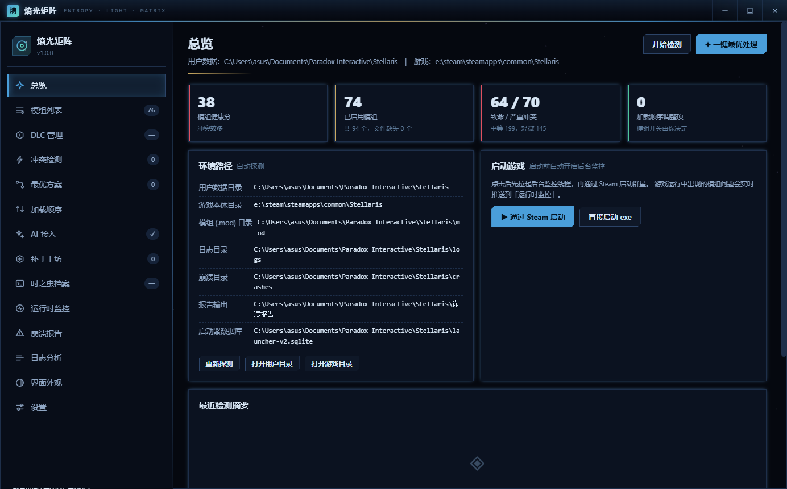
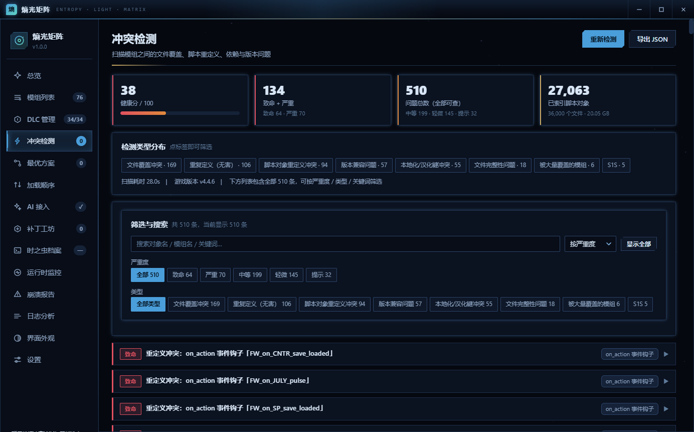
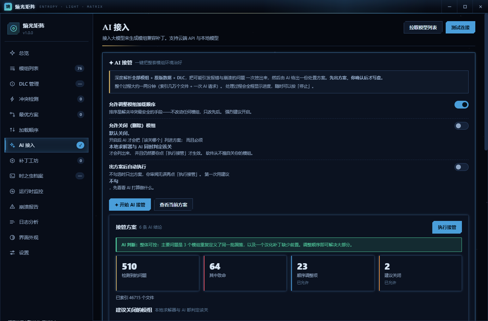
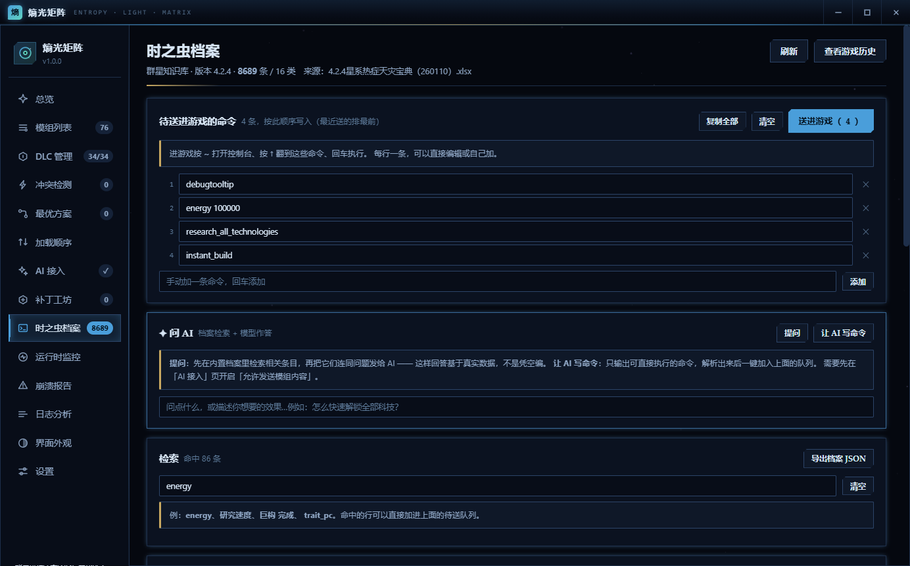
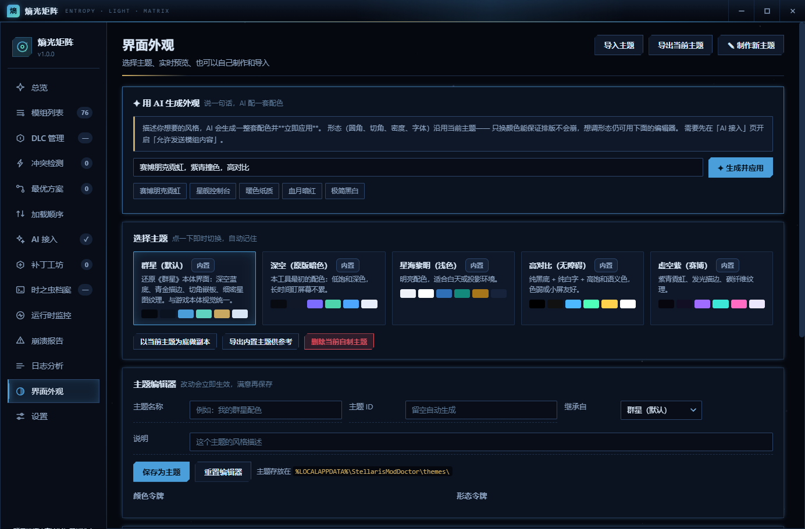

# 熵光矩阵 · Entropy Light Matrix

一个面向《群星》(Stellaris) 的**模组冲突诊断 + 智能排序启动器**。

它会自动分析你订阅的所有模组、找出它们之间的真实冲突、算出最优加载顺序并
一键落地；游戏运行期间在后台盯着模组报错；**游戏崩溃后自动把几万行英文日志
翻译成中文、加上成因注释、生成一份能直接发给别人的诊断报告**。



| 冲突检测 | AI 接管 |
| --- | --- |
|  |  |

| 时之虫档案 | AI 生成外观 |
| --- | --- |
|  |  |

---

## 目录

- [它解决什么问题](#它解决什么问题)
- [核心功能](#核心功能)
- [安装](#安装)
- [快速开始](#快速开始)
- [界面导览](#界面导览)
- [模组开关：自己决定加载哪些](#模组开关自己决定加载哪些)
- [DLC 管理](#dlc-管理)
- [AI 接入](#ai-接入)
- [本地自动补丁（不联网、不用 API）](#本地自动补丁不联网不用-api)
- [批量生成补丁](#批量生成补丁)
- [一键翻译：批量翻译所有模组](#一键翻译批量翻译所有模组)
- [跳转 Steam 创意工坊](#跳转-steam-创意工坊)
- [界面语言](#界面语言)
- [时之虫档案](#时之虫档案)
- [任务进度与停止](#任务进度与停止)
- [同一次只能开一个窗口](#同一次只能开一个窗口)
- [配置文件](#配置文件)
- [界面外观：主题系统](#界面外观主题系统)
- [它是怎么分析冲突的](#它是怎么分析冲突的)
- [模组开关由你决定](#模组开关由你决定)
- [补丁工坊：让 AI 或你自己给冲突打补丁](#补丁工坊让-ai-或你自己给冲突打补丁)
- [加载顺序](#加载顺序)
- [AI 分析：崩溃 / 日志 / 加载顺序](#ai-分析崩溃--日志--加载顺序)
- [崩溃报告长什么样](#崩溃报告长什么样)
- [自动关机与开机提醒](#自动关机与开机提醒)
- [命令行用法](#命令行用法)
- [安全性与可逆性](#安全性与可逆性)
- [项目结构](#项目结构)
- [开发与测试](#开发与测试)
- [已知限制](#已知限制)
- [许可](#许可)
- [参与开发](#参与开发)

---

## 它解决什么问题

群星装了几十个模组之后，玩家会遇到四种典型痛苦：

| 痛苦 | 表面现象 | 真实原因 |
| --- | --- | --- |
| **功能静默失效** | 装了某个模组，但它的科技/事件就是不出现 | 两个模组定义了同名的 `scripted_trigger`，后加载者把前者**整体覆盖**了，没有任何提示 |
| **启动即报错** | 进游戏就看到 "Could not find files for mod" | playset 里勾选的模组文件已被 Steam 取消订阅 |
| **玩到一半崩溃** | 毫无征兆闪退，`error.log` 有 6 万行 | 内存耗尽、脚本死循环、或某个模组文件损坏 |
| **看不懂日志** | `error.log` 8 MB 全是英文 | 99% 是无害噪音，真正致命的那几行藏在里面没人看得懂 |

本工具针对这四点各给出一套机制：**冲突检测**、**文件完整性检查**、
**运行时监控**、**日志翻译与注释**。

---

## 核心功能

### 联机校验排查

在「模组列表」点击「排查校验影响」，按当前游戏安装目录中的
`checksum_manifest.txt` 检查所有 MOD 的实际文件与 `replace_path` 声明。
结果分为「可能影响校验」「未命中校验规则」「尚不能判断」，可筛选并点击
状态查看具体文件依据。纯音乐、贴图或汉化不会因为名称、标签被直接判为嫌疑。

「暂存关闭已启用的嫌疑 MOD」只调整暂存开关，保留未命中与未知项；检查清单
和依赖后，沿用「写入群星」生效。写入前自动备份，可在备份页回滚；暂存时
可用「放弃全部改动」撤销。不会删除或修改 MOD 文件。

这是排查工具，不计算游戏最终校验码，也不保证与房主相同。双方仍需核对
游戏版本、MOD 版本和加载顺序；工坊更新后应重扫。缺少或无法解析游戏规则、
内容缺失、压缩包及读取失败会明确标为未知，不会当成安全项。

### 1. 自动分析检测模组冲突

不是简单对比文件名，而是真正解析群星的 Clausewitz 脚本语法树：

- **文件级覆盖** — 哪些模组提供了同一个游戏文件，谁覆盖了谁
- **语义级重定义** — 哪些模组定义了同名的游戏对象且内容不同
  （触发器、脚本效果、变量、`on_action`、舰船部件、科技、建筑……）
- **本地化键冲突** — 汉化模组之间互相覆盖了哪些文本键
- **依赖关系** — 缺前置、前置没启用、前置被排在后面
- **版本兼容** — 模组声明的支持版本与当前游戏版本是否匹配
- **文件完整性** — 已启用但文件丢失、幽灵条目、描述符与内容不一致

### 2. 安装最优选处理

- **分层排序** — 前置框架 → 大型机制 → 常规内容 → 界面 → 兼容补丁 → 汉化
- **拓扑求解** — 在满足依赖约束的前提下，让改动量最小
- **自动生成兼容补丁** — 对可安全合并的同名定义（脚本变量、静态修正量）
  自动生成一份覆盖补丁模组
- **写回真实配置** — 直接更新 Paradox 启动器的 `launcher-v2.sqlite`
  与游戏读取的 `dlc_load.json`

> **模组的开关权永远在你手上。** 程序只列出「建议关闭 + 理由」，
> **不会自动关掉任何模组**。详见[模组开关由你决定](#模组开关由你决定)。

### 3. 后台检测运行中的问题

游戏运行期间持续监控：

- 增量解析 `error.log`，用知识库实时翻译新出现的报错
- **错误爆发检测**（1 分钟内新增 300+ 条错误 → 立即告警）
- 内存占用趋势（群星加模组崩溃的第一大原因）
- 工坊模组在游戏运行中被更新（存档损坏高危操作）
- **崩溃目录监测** → 自动触发报告生成

### 4. 崩溃后自动生成带翻译注释的日志

- 解析 `exception.txt`，翻译异常码，**结合调用栈缩小原因范围**
- 把 `error.log` 按知识库聚合成「人看得懂」的错误分组
- 每个错误给出：**这句话在说什么 / 为什么会这样 / 怎么办**
- 明确区分「必须处理的错误」与「可以完全忽略的噪音」
- 输出 Markdown + HTML 双格式报告

### 5. 接入 AI 自动做兼容补丁

- 支持 9 家供应商：DeepSeek、OpenAI、Claude、Kimi、通义、智谱、
  OpenRouter、**Ollama 本地模型**、任意 OpenAI 兼容网关
- 针对冲突自动生成补丁模组，把两个模组的功能合并保留
- **发送前可预览**，**输出强制校验**（语法 / 幻觉引用 / 越权重定义）
- 也支持**自己手写补丁**，带 8 个模板与实时校验

详见[补丁工坊](#补丁工坊让-ai-或你自己给冲突打补丁)。

### 6. 加载顺序可视化排序

- 一键按最优解排序
- 手动上下移动、移到首尾，实时看到与自动结果的差异
- 只改顺序，**不动任何模组的启用状态**

### 7. 任务完成后自动关机 + 下次开机提醒

见[下文](#自动关机与开机提醒)。

---

## 安装

双击 **`StellarisModDoctor-Setup.exe`**，会出现一个中文安装向导。

> **关于名字**：软件显示名是「熵光矩阵 (Entropy Light Matrix)」，
> 但 exe、安装目录、注册表键、数据目录仍沿用历史的
> `StellarisModDoctor`。这是**刻意**的——它们同时决定了用户数据目录
> （`%LOCALAPPDATA%\StellarisModDoctor`，里面是配置、主题、备份），
> 跟着显示名改就等于让老用户的设置「消失」，旧卸载入口也会失效。
> 显示名与内部标识分开，是这类工具的常规做法。
>
> 从旧名字升级时，安装程序会**自动清掉旧的桌面/开始菜单快捷方式**，
> 不会出现新旧两个图标同时躺着。
>
> 名字取自群星的宇宙观：熵是热寂，光是文明在熵增里维持秩序的那点能量，
> 矩阵呼应「排布 / 加载顺序」。

安装向导会做这些事：

| 项目 | 说明 |
| --- | --- |
| 程序目录 | 默认 `%LOCALAPPDATA%\Programs\StellarisModDoctor`（**不需要管理员权限**，不弹 UAC） |
| **桌面快捷方式** | `熵光矩阵.lnk`，可在向导里取消勾选 |
| **开始菜单** | 程序入口 + 卸载入口 |
| 卸载登记 | 写入注册表，于是「设置 → 应用和功能」里能看到它、也能正常卸载 |

安装位置可以在向导里改。装到 `Program Files` 也可以，只是会弹一次 UAC。

### 卸载

三种方式任选：

1. 「设置 → 应用 → 已安装的应用」里点卸载
2. 开始菜单 → 熵光矩阵 → 卸载
3. 直接运行安装目录下的 `StellarisModDoctor-Uninstall.exe`

卸载会**保留**你的配置、主题、备份和日志（在
`%LOCALAPPDATA%\StellarisModDoctor\`），重装后设置还在。
想连数据一起清掉，用 `/purge`。

### 静默安装（给脚本用）

```bat
StellarisModDoctor-Setup.exe /S                       :: 静默安装
StellarisModDoctor-Setup.exe /S /D=D:\Apps\SMD        :: 指定目录
StellarisModDoctor-Setup.exe /S /noshortcuts          :: 不建快捷方式
StellarisModDoctor-Setup.exe /uninstall /S            :: 静默卸载
StellarisModDoctor-Setup.exe /uninstall /purge /S     :: 卸载并清除数据
```

安装/卸载过程会写日志到
`%LOCALAPPDATA%\StellarisModDoctor\installer.log`，出问题先看它。

### 免安装使用

不想安装也行：直接运行 `dist\StellarisModDoctor.exe` 即可，
功能完全一样（只是没有快捷方式）。

---

## 快速开始

### 方式一：直接运行打包好的程序

```
dist\StellarisModDoctor.exe
```

双击即可，无需安装 Python。

### 方式二：从源码运行

```bat
python -m venv .venv
.venv\Scripts\python.exe -m pip install pywebview pyinstaller
.venv\Scripts\python.exe run.py
```

需要 **Python 3.10+** 和 Windows 10/11（依赖系统自带的 Edge WebView2）。

### 上手流程

1. 打开程序 → 「总览」页会自动探测群星安装路径与环境
2. 点 **「开始检测」** 或直接点 **「✦ 一键最优处理」**
3. 到「冲突检测」页看结果，到「最优方案」页确认要做的改动
4. 点 **「✚ 应用方案」** 落地（会自动备份原文件）
5. 点 **「▶ 通过 Steam 启动」** 开游戏，程序在后台继续监控

---

## 界面导览

| 页面 | 作用 |
| --- | --- |
| **总览** | 健康分、模组统计、环境路径、启动游戏、收尾操作 |
| **模组列表** | 滑块选择加载哪些模组 + 跳转 Steam 工坊 + 版本/体量/内容标签 |
| **DLC 管理** | 按类别查看全部 DLC，逐个开关，批量操作 |
| **冲突检测** | 按严重度与类型筛选所有冲突，展开看证据与建议 |
| **最优方案** | 加载顺序对比（新序/原序/分层/变更原因）、补丁预览、一键应用 |
| **加载顺序** | 一键最优排序 + 手动微调，可视化对比 |
| **AI 接入** | 供应商、密钥、参数、隐私开关、连通性测试 |
| **补丁工坊** | AI 生成 / **本地自动生成** / 自己写 / **一键翻译** / 管理已装补丁 |
| **运行时监控** | 实时状态、峰值内存、高频错误排行、事件流 |
| **崩溃报告** | 崩溃记录列表、报告生成与预览、历史报告管理 |
| **日志分析** | 任意日志文件的中文注释分析 |
| **界面外观** | 主题选择、实时预览、主题编辑器、导入导出 |
| **设置** | 路径、监控参数、排序策略、**界面语言**、关机与提醒、备份回滚 |

---

## 模组开关：自己决定加载哪些

到「模组列表」页，**每一行左侧都有一个开关**，直接点就能选择这个模组加不加载。

### 关键设计：先暂存，确认后才写盘

点开关**不会立刻改你的游戏配置**，而是先进暂存区：

- 顶部出现醒目的提示条，列出「将启用 N 个 / 将关闭 N 个」以及具体名字
- 被改动的行会整行高亮，一眼看出改了哪些
- 确认没问题再点「**写入群星**」；点错了就「放弃改动」，什么都不变

这样避免了手滑就关掉几十个模组的情况——这是真实会发生的：
以前改一个开关就是一次不可逆写入。

**把开关拨回原位，那条改动会自动消失**，不会留下一条「假待写入」。

### 批量操作

| 按钮 | 作用 |
| --- | --- |
| 全部启用 / 全部关闭 | 整体开关（**自动跳过磁盘无内容的**） |
| 反选 | 开着的关掉、关着的打开 |
| **只启用 / 只关闭筛选结果** | 先用搜索框和筛选器圈出目标，再批量操作 |
| **只看不可用的** | 一键筛出磁盘上没内容的模组，方便决定要不要退订 |

筛选器支持：全部 / 已启用 / 未启用 / 有问题 / 汉化 / 大型模组 /
**磁盘无内容（不可启用）**。

### 为什么有些模组开关是灰的

如果某个模组的**内容根本不在磁盘上**，它的开关会被**禁用**（灰色，写着「不可用」）。
这不是程序坏了，而是那个模组确实加载不了：

| 原因 | 说明 |
| --- | --- |
| **已退订** | 你在 Steam 取消了订阅，但 Paradox 启动器的数据库还留着记录 |
| **工坊文件被清理** | 换硬盘、清 Steam 缓存、验证文件完整性都可能把 `workshop/content/281990/<id>/` 删掉 |

**为什么之前是能点但没反应**：这些条目写进配置后，游戏按路径去找内容，
找不到就什么也不加载——界面上却显示「已启用」。这个静默失败非常误导，
所以现在**在模型层就直接拒绝**，并告诉你原因。想用得先回 Steam 创意工坊
**重新订阅**，再点「刷新清单」。

本机的情况：94 个模组里有 17 个属于这一类。

**注意区分**：下面这些**不算**不可用，它们的开关正常，照常可以启用——

- 描述符版本不一致（`mod/` 写 v4.4.6，`descriptor.mod` 写 v4.5.2）
- 缺少前置依赖（只是提醒你装前置）
- 启动器数据库有记录但找不到 `.mod` 描述符（内容还在，仍能加载）

判定只看「磁盘上有没有东西可加载」，不看元数据告警。

---

### 写入到哪里（这点很重要）

点「写入群星」会同时写**两个地方**：

| 位置 | 作用 |
| --- | --- |
| `launcher-v2.sqlite` 的 `playsets_mods.enabled` | **权威来源**。Paradox 启动器每次启动都按它重建模组清单 |
| `dlc_load.json` 的 `enabled_mods` | 游戏实际读取的清单，启动器不在时也生效 |

**只写 `dlc_load.json` 是不够的**——下次打开 Paradox 启动器，
它会按数据库里的记录把你改的覆盖回去。开发时就踩过这个坑：
关掉一个模组后重新读取，发现它还是「已启用」，因为库里没改。

如果 **Paradox 启动器正在运行**，程序会跳过写数据库
（它会锁文件并在退出时覆盖），并在结果里明确告诉你这一点。
这种情况建议关掉启动器再操作一次。

写入前会自动备份 `dlc_load.json`，可以在「设置 → 备份回滚」里还原。

---

## DLC 管理

到「DLC 管理」页可以看到**游戏目录下全部已安装的 DLC**，
按类别分组：大型资料片 / 内容包 / 种族包 / 故事包。每个都能单独开关。

### 数据从哪来

直接读游戏 `dlc/` 下每个子目录里的 `*.dlc` 描述符，所以显示的是
**你机器上真实安装的** DLC，而不是网上抄来的清单。每个 DLC 会解析出：

- 内部名称（游戏标识）
- `steam_id`（对得上商店页面）
- 类别（`expansion` / `content_pack` / `species_pack` / `story_pack`）
- 是否**影响存档兼容**（描述符里的 `affects_compatability`）

### 有个交叉验证

页面会显示一行绿色提示，例如：

> 交叉验证：最近一次崩溃记录里游戏加载了 31 个 DLC（游戏版本 4.4.6）

这来自最近一次崩溃转储里的 `meta.yml`——它记录了游戏**实际加载**的 DLC，
是唯一权威的旁证。用它来确认我们读到的清单和游戏认知一致。

本机的情况是：装了 34 个 DLC，游戏实际加载 31 个，差的 3 个是
未拥有的（`Symbols of Domination`、`Paradox Account Sign-up Bonus`、
`Creatures of the Void Portrait Pack`）。清单和游戏完全对得上。

### 写入格式的兼容处理

`disabled_dlcs` 里到底该写文件夹名、内部名称还是本地化键，官方没有公开文档。
所以程序**三种写法都认**（还有大小写差异、带 `.dlc` 后缀、带 `dlc/` 路径前缀
这些变体），写入时统一用文件夹名。测试里对着真实的崩溃记录验证过：
我们从 `.dlc` 里解析出的名字与游戏 `meta.yml` 里列出的名字**逐字一致**。

**认不出来的条目会被原样保留**，不会被程序擅自删掉——
如果你的配置里有别的东西写了 `disabled_dlcs`，它不会被动。

### 注意

关闭 DLC **会影响存档兼容性**：已经在存档里使用过相关内容（例如某资料片的
起源、飞升、物种）的游戏，可能无法正常读取。界面上每个受影响的 DLC
都标了「影响存档兼容」，批量关闭时也会弹确认框。

DLC 开关同样走「暂存 → 确认 → 写入」，同样自动备份。

---

## AI 接入

「AI 接入」页填好供应商、密钥、模型，点「**测试连接**」验证。
测试只发一句固定问候语，**不含任何模组内容**。

### 模型是真正的下拉框

「模型」是一个**下拉选择框**（不是输入框+建议列表），点「**拉取模型**」
会把服务商实际可用的模型填进去，直接选即可。

> 早期版本用的是 `<input list=datalist>`。在 WebView2 里 datalist 只是个
> 「输入建议」，点一下**不会弹出可选列表**——用户看到的就只是一个填着
> 默认值的文本框，根本没法在下拉里选。现在换成了真正的 `<select>`。

列表里没有你要的模型，用下面的「**手动填写**」直接输名字，它会加进下拉框并选中。

### 「待测」是什么意思

侧栏 AI 那一项的角标有三种状态，鼠标悬停有说明：

| 角标 | 含义 |
| --- | --- |
| **未配置** | 还没填 API Key（本地 Ollama 不需要密钥） |
| **✓** | 上次「测试连接」成功 |
| **待测** | 已配置，但还没成功测过 —— 建议点一下「测试连接」 |

### 拉取失败时不会骗你

「拉取模型」如果请求失败（密钥没填、地址不对、网络不通），
界面会**明确说「没能拉到」，并说明下面列的是内置预设、
不代表你账号里真的有这些模型**，同时给出失败原因。

> 早期版本无论成功失败都显示「拉取到 N 个模型」——失败时返回的是
> 供应商预设里的常见模型名（例如 DeepSeek 就是 `deepseek-chat` 和
> `deepseek-reasoner` 这两个），于是用户看到「拉取到两个」但发现
> 名字根本不对、也用不了。现在接口会返回模型**来源**
> （`api` / `fallback`），界面据此如实说明。

### 填完就能测，不必先保存

刚输入的密钥/地址/模型会**立即用于测试与拉取**，不需要先点「保存配置」。
这一点很关键：旧版必须先保存，否则请求带着空密钥发出去必然失败，
而失败又被静默显示成「拉取到 N 个模型」。

### 换供应商会自动换模型

切换供应商时会同时重置**模型**与**接口地址**为该供应商的默认值。
否则从 DeepSeek 切到 OpenAI 时，模型名还留着 `deepseek-chat`，
测试必然失败而用户看不出原因。

---


### AI 接管：一键把整套模组环境治好

「AI 接管」把整条链路串成一个动作：

1. **深度解析** —— 索引全部模组 **+ 原版数据 + DLC**（本机是 46715 个文件）
2. **检测冲突** —— 在完整索引上跑一遍冲突检测，把可能引发报错与崩溃的
   问题一次挖出来
3. **本地求解** —— 算出最优加载顺序
4. **AI 深度判断** —— 把冲突、模组清单、顺序、求解器建议一起交给 AI
5. **出方案 → 你确认 → 写盘**

全程有进度条，随时可以按「停止」。

#### 开局的两个选择

这是你要求里最要紧的部分 —— **动你的东西之前必须先问**：

| 选项 | 默认 | 含义 |
| --- | --- | --- |
| **允许调整模组加载顺序** | 开 | 排序是解决冲突最安全的手段：不改动任何模组，只改先后 |
| **允许关闭模组** | **关** | 开启后 AI 才会把"该关哪个"列进方案 |
| **出方案后自动执行** | **关** | 不勾选时只出方案，你审阅无误再点「执行接管」 |

两个都关掉 → **只诊断，一个字节都不改**。

#### 关闭模组有两道闸门

即便你打开了「允许关闭模组」，一个模组要被列进方案还需要：

1. **本地求解器也建议关它**（文件丢失、重复定义且排序无法解决…）
2. **AI 也判定该关**

两个独立判断的交集才会出现在列表里。误关的概率因此低得多 ——
而最终仍然要你亲手点「执行接管」。**软件从不擅自关你的模组。**

#### 「能正常启动游玩」是有判据的

接管执行完会给一份结论，不是一句"完成"：

- 写回后 `dlc_load.json` 里**启用了多少个模组**（0 个就是出事了）
- **剩余致命冲突**还有多少条
- 结论 `launch_ok` 为假时界面会明确警告，而不是假装成功

写盘走的是和「一键最优处理」**同一条链路**（先备份 → 写库 →
写 `dlc_load.json`），不另起一套 —— 那是最容易出错的地方。


## 本地自动补丁（不联网、不用 API）

「补丁工坊 → ⚙ 本地自动补丁」。**完全不联网、不调用任何 AI**，
用内置规则分析冲突检测的结果，做机械、可解释的修复。

### 为什么要有这个模式

AI 生成补丁很好用，但有时候你就是不想把模组内容发出去、不想配 API Key、
或者只想快点了事。这个模式零配置、瞬间完成（本机 516 条冲突 → 80 份草稿，
**0.16 秒**）。

设计原则是**看不懂就不生成**——错误的模组补丁比没有补丁更糟。
每条补丁都带：依据（哪两个模组、哪个文件）、改动内容、为什么安全、
置信度（高/中/低）。

### 内置规则

| 规则 | 适用问题 | 做法 |
| --- | --- | --- |
| **文件合并** | 两个模组改了同一个文件（F1） | 块级保守合并（见下） |
| **本地化补齐** | 本地化键缺失/冲突（L1） | 补占位译文，让游戏里不再显示生涩的键名 |
| **版本声明修正** | 模组声明版本与游戏差一个大版本（V1） | 生成修正说明与可直接套用的版本行 |
| **重复定义说明** | 内容相同的重复定义（S2） | 只作说明，不生成补丁（这种情况是良性的） |
| **前置缺失说明** | 缺少前置模组（D1） | 生成安装说明（前置无法自动装） |

### 文件合并是怎么做的

群星脚本里**命名对象是整体覆盖**的，所以合并的最小单位是**块**而不是行：

- 两边内容相同的块 → 只保留一份
- 只有一边改动的块 → 直接采纳
- 两边都改了同一块 → **真冲突**，保留当前生效的版本，并在补丁头部列出来

本机的实际效果：76 个文件冲突里，大量是「A 加了个建筑、B 改了个科技」
这种本来可以共存的改动，合并后两边都保留。

**但要说清楚**：合并会**带回一部分当前被完全丢弃的改动**（来自输的那一方）。
这是合并的价值，但也意味着**游戏行为会变**——所以它标成中等置信度，
界面上也明确提示「请当成一次需要复查的改动，而不是无风险的清理」。
低置信度的补丁默认不勾选。

### 一个真实的坑

第一版合并用 `{块名: 块内容}` 的字典来配对。但群星文件里**同名顶层块极其常见**
（`common/component_templates/` 下几十个 `utility_component_template = { ... }`），
字典会让它们互相覆盖——合并结果只剩最后一块，**静默丢掉整个文件的内容**。

现在按「出现次数」分组配对，并且加了一道自检：合并结果必须**至少保住
胜者原有的全部块**，少一个就整份放弃生成。测试里 76/76 份合并补丁都过了这道检查。

---

## 批量生成补丁

「补丁工坊 → ⚡ 批量生成补丁」。一次选中多个冲突目标批量处理，**引擎可选**：

| 引擎 | 说明 |
| --- | --- |
| **本地规则** | 不联网、免费、几秒完成。只处理机械可判定的类型 |
| **AI 生成** | 联网发送模组内容、按 token 计费。能处理需要理解设计意图的语义冲突 |

### 目标是可批量勾选的

列表会列出全部可修复的冲突，**默认全选**，支持：

- **全选 / 全不选**
- **只选本地能处理的** —— 一键排除掉本地规则搞不定的类型
- **只选需要 AI 的** —— 本地跑完一轮之后，剩下的就是这批，接着切 AI 处理
- 每行都标注了「本地可做」还是「需 AI」，一眼看出差距

本机实测：282 个候选中，**188 个本地可处理、94 个需要 AI**。
选本地模式时那 94 个会被**跳过并明确告知**，不会假装成功。

### 处理完的目标会从列表移除

跑完一轮批量后，被处理掉的目标**从列表里消失、计数随之减少**，
不用手动刷新，也不会看着数字没变而以为没生效。

本机实测：跑完一轮本地批量后，待处理目标 **282 → 206**，
本地可处理数 **188 → 112**。

> 这里有个容易踩的坑：补丁**生成**之后还没保存到磁盘，
> 而"哪些冲突已被解决"原本靠扫补丁目录来判断——自然看不到内存里的草稿。
> 所以单独记了一本「本轮处理过什么」的账，生成阶段就先把它们摘掉。
>
> 两个引擎各记各的账：本地做过的不该从 AI 的列表里消失，
> 否则你会漏掉那些"本地做不了、但 AI 能做"的目标。

### 两种结果的去向不同

- **本地引擎**产出的是草稿，切到「本地自动补丁」页复核后写入
- **AI 引擎**产出的是已校验的补丁，切到「AI 生成补丁」页逐个保存
  （有严重问题的会被拒绝保存）

### 生成完要保存，可以一次性全部保存

生成出来的只是**草稿**，要保存成模组才会生效。「批量生成补丁」页有
**「全部保存为补丁模组」**，不用逐个点。

- **所有补丁合并成一个模组**：「熵光矩阵 · 兼容补丁」（`zzz_SMD_` 前缀，
  排在最后加载）。后续再生成的补丁会**并进同一个**，
  不会每生成一次就多出一个。启动器列表里始终只有这一个，
  想整体关掉也只点一下。
- 改了哪个文件、针对哪个冲突，靠模组内的 `SMD_MANIFEST.json` 记账，
  `README_SMD.txt` 按账本重新生成——合并了也不丢可追溯性。
- 同名文件**以最新一次为准**。
- 启动时会把**早期版本遗留的**多个补丁模组自动并进统一补丁，
  旧目录与它的 `.mod` 一并清掉。
- 任何一个失败都不影响其余的，最后汇总告诉你成功几个、失败几个、为什么。
- 保存计划会**提前列出会被拒绝的**（模型没给出文件、或有严重校验问题），
  不用等点了保存才发现少了一半。
- **幂等**：已保存的不会再次出现在待保存列表里，重复点也不会重复写。

### 已被补丁解决的冲突不再显示

保存之后，那些冲突会**从冲突列表和补丁工坊里消失**。否则你打完补丁回来一看
"问题还在"，以为白做了一遍。

判据要求**精确命中**才隐藏，宁可多显示也不误藏：

| 判据 | 覆盖的情况 |
| --- | --- |
| 补丁里有**同名文件**（整条路径） | 补丁直接重写了那个文件 |
| 补丁里有**同基础文件名** | 本地规则的补丁叫 `zzz_SMD_auto_merge_<原名>`，路径对不上但文件是同一个 |
| 补丁里出现**同名顶层定义** | 对象重定义（S1）被补丁钉住 / 合并后即消失 |
| 补丁里出现**同名本地化键** | 本地化冲突（L1）被补丁补齐后即消失 |

冲突页的类型筛选条上会多出一个 **「已由补丁解决 N」**，点一下就能
把那些条目显示回来，方便核对补丁到底盖住了什么。

> 「同基础文件名」这一条是补出来的。本地规则的补丁写出来叫
> `zzz_SMD_auto_merge_00_biogenesis_utilities.txt`，而冲突报告里的目标是
> `00_biogenesis_utilities.txt`——只比整条路径的话一条都匹配不上。
> 修好后隐藏数从 **24 涨到 100**，冲突列表 510 → 410，补丁候选 282 → 205。

### 补丁模组自己不算冲突源

补丁模组**天生**就是"排在最后、整份覆盖"，那是它的工作原理。
把它当普通模组参与检测，会得到一堆没意义的结论：它覆盖别人是设计意图、
它自己会被统计成"被大量覆盖的受害者"、它钉住的定义全被报成"重复定义"。

所以补丁模组**只作为"解药"参与统计，不作为"病灶"参与检测**。
本机实测：装上含 79 个文件的补丁后，冲突数与不装时完全一致。

---

## 一键翻译：批量翻译所有模组

「补丁工坊 → 🌐 一键翻译」有两种做法：**让 AI 翻**，或者**你自己翻**。

### 方式一：AI 批量翻译

把模组的本地化文本批量翻成你想要的语言。

### 支持 10 种语言

简体中文、English、Français、Deutsch、Español、Русский、Polski、
Português (Brasil)、日本語、한국어 —— 都是游戏原生支持的语言后缀。

### 不会重复翻译，也不会覆盖人工翻译

这是最关键的一点。汉化通常是以**独立模组**形式存在的：ACOT 的英文键由
「ACOT临时汉化」提供中文。如果只看单个模组的目录，就会以为这些键没翻译过，
白白再翻一遍——**既浪费钱，又可能用机翻覆盖掉人工翻译的好译文**。

所以程序会**跨全部模组**统计目标语言已有的键。本机实测：
77 个模组里已有 61,934 个键有中文译文，全部跳过；只剩 305 条真的需要翻。

### 译文写在哪

写成一个**独立的补丁模组** `SMD 机器翻译补丁`，不动原模组目录：

- 原模组会被 Steam 更新覆盖，写进去的译文会丢
- 改别人的模组目录不礼貌
- 独立模组可以在「已安装的补丁」里一键删除

文件名前缀 `zzz_SMD_tr_` 保证加载顺序排最后，从而**覆盖**原模组的英文原文。

### 校验：模型很爱自作主张

模型返回的键必须**原样存在**于请求里，否则一律丢弃。测试覆盖了这些真实错误：

| 模型的行为 | 处理 |
| --- | --- |
| 漏翻几条 | 记录下来，其余照收 |
| **凭空造键** | 丢弃并报告 |
| 改写键名（大小写不同） | 不放行 |
| 用 markdown 代码块包起来 | 自动剥掉 |
| 前后加一句「好的，这是翻译：」 | 能容忍 |
| 返回空字符串 | 丢弃 |
| 返回数组 / 非 JSON | 整批拒绝 |

### 费用与隐私

翻译会把模组文本**发送给 AI 服务商**，按 token 计费。程序会在开始前
弹确认框说明这一点，并且**必须先到「AI 接入」页开启「允许发送模组内容」**
—— 没开就拒绝执行。

先用「试翻条数」翻 50 条看看质量，满意再翻全部。

### 方式二：自己翻译

不想用 AI、或者想手工校订机器翻译时用。

点「**载入待翻译条目**」，界面会把待翻译内容列成一张**两列表格**：
左边是原文（含本地化键、所属模组），右边是输入框。填完点
「**保存我填的译文**」即可。

- 只列出**目标语言还没有译文**的条目，不会让你重复劳动
- **留空的行不会写入** —— 空字符串会让游戏显示空白，比没翻译更糟
- 译文同样存进独立的翻译补丁模组，不动原模组目录

---

## 跳转 Steam 创意工坊

模组列表里每个工坊模组名字后面都有个 **`Steam ↗`** 小标签，点一下
直接在浏览器打开它的创意工坊详情页。

- 链接由模组的工坊 id 拼出，本机 76 个工坊模组全部核对过 id 一致
- 本地模组没有工坊页面，不显示这个标签

---

## 界面语言

「设置 → 界面语言」可以切换 **简体中文 / English**，只影响本软件界面，
不影响游戏内语言。

界面文案走 key 查表（`smd/web/i18n.js`），**两张表的键集合完全一致**，
测试会检查这一点，也会检查代码里用到的每个键都在表里——
缺键会让界面残留另一种语言，是很难发现的问题。

> 说明：目前完成度是**侧栏、页面标题、模组列表、DLC、补丁工坊、设置**
> 这些主要界面。总览/冲突/日志等页面的正文仍是中文，后续会补齐。

---

## 时之虫档案

群星知识库。「指令台」不再是独立页面——它是档案里
**把命令送进游戏**的那个功能区。

数据来自你给的《4.2.4 星系热症天灾宝典》表格，
由 `tools/build_wiki.py` 抽取成 `smd/data/wiki.json` 随程序分发：

**8689 条 / 16 类**（扩展代码 755、全局修正 2867、舰船组件 1427、
科技 663、行星矿藏 576、巨构 497、物种特质 352、异常点 326、
国策 265、传统 249、事件 244、成就 211、遗珍 132、起源 66、
飞升天赋 47、组合代码 12）。

> 为什么内置而不是直接看表格：那份表 4.5 MB、27 个工作表，
> Excel 打开慢、手机上更打不开，而且**没法搜索**——
> 想找一条命令只能肉眼扫几千行。内置之后可以秒级全文检索。

### 检索

顶部搜索栏，**多个词用空格分隔、要求全部命中**（AND）。
搜「巨构 完成」时只命中一个词的几千行没有意义。

命中按精确度排序：完全相等 > 以关键词开头 > 包含。

### 待送队列（在页面最上面，可直接编辑）

检索或浏览时点「＋ 加入」，命令就进队列。队列的特点：

- **每一行都是输入框，可以直接改** —— 参数不对不用删了重加
- 顺序就是写入顺序
- 支持手动敲一条（回车即加）
- 送进游戏时**自动跳过空白行**
- 「复制全部」可以直接粘进游戏控制台

### 怎么在游戏里用

挑好命令 → 点「送进游戏」→ 进游戏按 <kbd>~</kbd> 打开控制台 →
按 <kbd>↑</kbd> 翻出刚送进去的命令 → 回车执行。

群星的控制台**只能**在游戏里手敲，官方没有任何外部执行接口。
唯一持久可用的通道是 `<游戏本体目录>/console_history.txt`，
游戏把它当作"输入过的命令"。所以软件**写它**、你在游戏里**按 ↑ 取用**。
这样不改游戏、不装 mod，也不会被反作弊或文件校验挡住。

> **不做的事**：不往游戏进程里注入按键、不伪造控制台输入。
> 那类做法依赖未公开的内存结构，游戏一更新就崩，还可能被判定为作弊。

### 安全措施

- 推送前**自动备份**原历史到 `console_history.backup_<时间>.txt`
- 保留你原有的历史，新命令插在最前面
- 重复命令自动去重
- **默认不截断**历史的任何一条。真实历史 516 行、其中 414 条不重复，
  早先默认砍到 200 行会静默丢掉 100 多条你自己的命令——
  现在截断只在明确要求时才做，并如实报告丢了多少

### 关于那张表的抽取

各页结构差异很大（表头行号 2~6 不等、大量合并单元格、页首还有说明行），
所以 `build_wiki.py` **按页手工描述抽取规则**，不硬套一套通用逻辑——
通用逻辑在这种人工维护的表上一定会出错。

表里的内容按原样收录（含 `research_technology tech_p...` 这类被表格
截断的写法），因为那是作者写的原始资料。需要完整代码时以游戏内 `help` 为准。


### 用 AI 问档案

档案页顶部有两个 AI 入口：

- **提问** —— 先在内置档案里检索相关条目，再把条目连同问题发给 AI。
  这样回答基于真实数据，不是凭空编。
- **让 AI 写命令** —— 只输出可直接执行的命令，解析出来后一键加进待送队列。

#### 中文提问要能检索到东西

档案检索原本是"多关键词全部命中"（AND）。这对搜索框是对的，
但**对自然语言提问完全不工作**：问"怎么快速解锁全部科技"，
按空格切词只会得到整句一个元素，一条都匹配不到 ——
检索为空就等于白白浪费一次 AI 调用。

所以提问走的是另一条路径：

1. 先用原句做 AND 检索（问题恰好由词条关键词组成时最精确）
2. 一条都没有 → 切成**档案里真的存在**的词，改做 OR 检索

切词的关键是**从单元格内容里展开 n-gram**，而不是拿整格当词表：
档案里的格子常常是一整句话（例如「设定国家已完成完整巨构
（用于解锁星河奇迹）」），整格匹配的话"解锁"永远不在词表里。

实测：

| 提问 | 切出的词 | 命中 |
| --- | --- | ---: |
| 怎么快速解锁全部科技 | 解锁全部 / 快速 / 解锁 / 科技 | 250 条 |
| 怎么让舰队无敌 | 舰队 / 无敌 | 218 条 |
| 我想要一大堆资源 | 资源 | 269 条 |

OR 检索会把"只沾一个词"的行也捞进来，所以最后按**覆盖度**重排：
命中词越多越靠前。


## 任务进度与停止

耗时任务（扫描检测、AI 生成补丁、批量翻译）在右下角显示一个**进度浮层**：
任务名、当前步骤、百分比、已用时间，以及一个**停止**按钮。

- 进度条是**斜纹流动**的，一眼能看出在跑
- **进度不可估算时**（例如等 AI 回包）改成来回扫动并显示 `∞`，
  不会卡在一个假百分比上骗人
- 底部状态栏保留一条细线，扫一眼就能看到

### 停止是「请求取消」，不是强杀

点「停止」只置位取消标志，**不强杀线程**：正在进行的写盘不会被中断，
耗时步骤会在自己的循环里查到标志后主动退出。按钮随之变成
「正在停止…（等待当前步骤收尾）」，避免用户以为没点上而反复点。

停止后界面提示的是**「已停止」而不是「完成」**，并且：
**残缺的结果不会被发布** —— 否则界面会拿着半截数据刷新，
看起来像检测成功了，那比停下来更糟。

### 哪些能停、哪些不能

| 任务 | 可停止 |
| --- | --- |
| 扫描与冲突检测 | 可以（每扫一个模组检查一次） |
| 求解最优方案 | 可以 |
| AI 生成 / 批量生成补丁 | 可以（逐个目标之间） |
| 批量翻译 | 可以 |
| 本地规则批量补丁 | 可以（每 20 条检查一次） |
| 生成崩溃报告 | **不可以**，按钮置灰并说明原因 |

报告生成是"最后一步落盘"型的活，中途停掉只会留下半份文件；
它本身也很快。这类任务界面会把停止按钮**置灰并说明原因**——
给一个点了没用的按钮比不给更糟。

---

## 同一次只能开一个窗口

程序用 Windows 命名互斥体做**单实例保护**。重复启动时不会开出第二个窗口，
而是**把已经打开的窗口切到前台**并立刻退出。

为什么必须拦：两个实例会同时改同一批游戏文件（`dlc_load.json`、
启动器数据库、`.mod` 描述符）。这类写入没有跨进程锁，
两边各自"备份 → 改 → 写回"交错执行时，后写的会把前一个的改动整个盖掉，
用户看到的是「我明明点了写入，模组却没变」。

> 第二实例用的是"切到前台"而不是弹提示框。提示框是**模态阻塞**的，
> 没人点它进程就一直挂着——从开始菜单误点两次就会留下一个关不掉的隐藏进程。
> 而且用户真正的意图是"我想用这个软件"，把已有窗口调出来正好满足它。

---

## 配置文件

位置：`%LOCALAPPDATA%\StellarisModDoctor\config.json`（UTF-8，无 BOM）。

里面存着 AI 供应商、模型名、API Key、路径、主题等。它**被默认值覆盖过好几次**，
所以做了三层保护：

1. **原子写入** —— 先写 `.tmp` 再改名。直接覆盖时若写到一半崩了，
   会留下一个截断的 JSON；下次启动解析失败就静默退回默认值，
   用户的设置全没了。
2. **每次保存前留 `.json.bak`** —— 覆盖前的上一版。
3. **损坏自动恢复** —— 主文件读不出来时，从 `.bak` 恢复。
4. **AI 段被重置时自愈** —— 当前配置的 AI 段完全是出厂默认、
   而 `.bak` 里确实配过时，读配置时自动把 AI 段接回来。

> 第 4 条是补出来的：AI 配置在这个项目里被莫名重置过多次
> （供应商从 `ollama` 变回 `deepseek`、模型名丢失），一直没定位到是谁写的。
> 与其继续找，不如让**下一次读配置时自动修复**——用户不必再重填一遍。
> 只在"当前是纯默认、备份确实配过"两个条件同时成立时才动手，避免误判。
>
> 另外加了**绊线**：磁盘上的 AI 段与某次要写入的值不一致时，
> 会把**变化明细 + 调用栈**记到 `logs/config_overwrite.log`。
> 起初的判据是"新值正好等于出厂默认"，太窄 —— 实测发生过
> `ollama/nemotron` → `deepseek/deepseek-chat` 的覆盖，新值不是默认，
> 绊线一声不吭，白排查了一轮。改成比较"AI 段是否真的变了"之后，
> 第一次跑就抓到了真凶。

**关于 API Key 的安全性（说实话）**：密钥只存在这个 `config.json` 里，
**不会被打进安装包**，安装包只装程序本体，配置是运行时才生成的。
它放在 `%LOCALAPPDATA%` 下，别的普通用户账号读不到。
但要注意：代码里那句 `os.chmod(0o600)` 在 Windows 上**基本是空操作**
（`chmod` 改不了 ACL），实测该文件的 ACL 仍是继承来的
「自己 / SYSTEM / Administrators 完全控制」。
所以它防的是同机器上的其他普通用户，**不防管理员**——
这也符合 Windows 上用户级配置的一般预期，但别把它当成加密存储。

> 第 3 条有个前提：`.bak` 必须**确实有内容**才拿来恢复。
> 默认配置本身也是合法 JSON，光看"能不能解析"分不出
> 「用户配置」和「一份默认值」；不加这道判断的话，
> 拿默认备份去"恢复"等于什么也没救回来，还掩盖了问题。

`tools/config_test.py` 覆盖了以上全部行为（14 项断言，跑在沙箱里不动真实配置）。

### 测试沙箱必须覆盖游戏目录

`tools/sandbox.py` 提供 `enter_sandbox()`，默认只把 `LOCALAPPDATA`
指到临时目录。但**补丁模组是写进 `<user_dir>/mod/` 的**，那不是
`LOCALAPPDATA`——只切它挡不住。

所以凡是要**保存补丁 / 写游戏配置**的测试必须用
`enter_sandbox(game_dir=True)`。它只把**可写的** `user_dir` 指向沙箱，
`game_dir` 与 `workshop_dirs` 保持真实，这样：

- 扫描仍能看到真实模组、扫出真实冲突（指到空目录只会得到一堆"文件完整性"误报）
- 所有写入落在沙箱里

> 这个开关是补出来的：`batch_save_test` 最初漏了它，
> 一次运行往用户真实游戏目录里写进了 **89 个补丁模组**。
> 现在那个测试会同时断言"真实 mod 目录条目数不变"。

---

## 界面外观：主题系统

界面**默认就是群星风格**：深空蓝底、青金描边、切角嵌板、细密星图纹理。

### 图标是自绘的

界面里的图标（侧栏、工具栏、统计卡）全部是**自绘 SVG**，
笔画用 `currentColor`，因此会跟着主题色一起变。

左上角的品牌标记与程序图标同源：渐变环 + 青色核心 + 星点，
只是换成了矢量绘制，能随主题换色。

> 早期版本用的是 Unicode 符号（`◈ ▤ ◇ ⚡ ✦`）。那些字符的字形由
> **系统字体**决定，不同机器上粗细、大小、基线都不一样，
> 而且只能靠字体色，做不出层次。自绘 SVG 才能保证 5 套主题下都一致。

### 内置 5 套主题

| 主题 | 风格 |
| --- | --- |
| **群星（默认）** | 还原游戏本体：深空蓝 + 青金描边 + 切角嵌板 + 星图纹理 |
| **深空（原版暗色）** | 本工具最初的配色，低饱和、耐看 |
| **星海黎明（浅色）** | 明亮配色，适合白天或投影 |
| **高对比（无障碍）** | 纯黑底 + 纯白字 + 高饱和语义色，色弱/小屏友好 |
| **虚空紫（赛博）** | 紫青霓虹、发光描边、碳纤维纹理 |

到「**界面外观**」页点一下即可切换，自动记住。页面下方还有一块
**效果预览**，用真实的按钮/徽章/卡片/提示条展示这套主题长什么样。

### 主题是怎么做的

整套视觉由 **29 个颜色令牌 + 14 个形态令牌**驱动，
样式表（`smd/web/theme.css`）里**不写死任何颜色**：

| 令牌类别 | 例子 |
| --- | --- |
| 背景层次 | `bg` `bg2` `panel` `panel2` `panel3` |
| 线条 | `line` `line2` `lineglow` |
| 文字 | `fg` `dim` `dim2` |
| 强调 | `acc` `acc2` `acc3` `acctext` |
| 语义 | `crit` `high` `med` `low` `ok`（各带 `on*` 前景色保证对比度） |
| 形态 | `radius` `clip` `clip_size` `texture` `glow` `uppercase_title` `font` `font_title` `font_mono` `sidebar_w` `density` `texture_op` |

低透明度底纹（徽章背景、选中态、告警卡）由主色**自动派生**——
改一个 `acc`，所有相关地方会一起变。

背景纹理（星图/网格/碳纤/六边形）用内联 SVG 生成，不额外请求文件。
「切角嵌板」用 `clip-path` 实现群星那种斜切角，配合发光描边。

### 自己做一个

到「界面外观 → 主题编辑器」：

- **颜色令牌**：每个都带取色器 + 十六进制输入框，**拖动即时预览**
- **形态令牌**：切角开关、圆角大小、纹理类型、发光强度、字体、侧栏宽度……
- 「继承自」可以选一份基座主题，只改你想改的部分

改满意后填个名字点「保存为主题」，会存到
`%LOCALAPPDATA%\StellarisModDoctor\themes\<id>.json`。

起步建议用「**以当前主题为底做副本**」，或点
「**导出内置主题供参考**」（把 5 套内置主题各导出一份，照着改）。

### 导入别人做的主题

点「**导入主题**」选一个 JSON 文件即可。导入时会**严格校验**：

| 检查 | 行为 |
| --- | --- |
| 颜色格式 | 只接受 `#rgb` / `#rrggbb` / `#rrggbbaa` / `rgba()` / `transparent`，其它**拒绝** |
| 形态取值 | 枚举越界、尺寸非法、类型错误都**拒绝** |
| 未知令牌 | 忽略并提醒（不往 CSS 里注入任意内容） |
| 缺失令牌 | 从基座主题补齐，保证界面不会出现「无颜色」的洞 |
| id 冲突 | 自动改名，不覆盖你已有的主题 |

**坏主题文件进不来，界面不会被搞崩。**

### 分享

点「**导出当前主题**」生成一份 JSON，发给别人导入即可。
主题文件是**纯 UTF-8 无 BOM** 的 JSON，任何编辑器都能改
（BOM 会让不少 JSON 解析器直接报错，所以特意不加）。

---

## 它是怎么分析冲突的

### 为什么必须真正解析语法

考虑这段脚本：

```
# 模组 A
my_trigger = { has_technology = "tech_x" }

# 模组 B
my_trigger = { num_pops > 25 }
```

用正则或文件名比对**完全看不出问题**——它们在两个不同的文件里。
但群星的规则是：`my_trigger` 这个名字全局唯一，**后加载的定义整体替换先加载的**。
结果就是模组 A 里所有依赖 `my_trigger` 的逻辑静默失效。

本工具会把每个模组的脚本解析成语法树，提取所有顶层具名定义及其内容指纹，
然后跨模组比对同名定义。**内容完全相同**的重复定义会被单独归类为「无害」，
只有内容冲突的才报为问题。

实现细节见 `smd/paradox.py`（解析器）与 `smd/scanner.py`（索引）。

### 已知的精度处理

真实的群星模组生态里有大量「看起来像冲突、其实不是」的情况，本工具做了针对性排除：

| 情况 | 处理 |
| --- | --- |
| `@variable` / `$variable$` | Clausewitz 的**文件局部**宏，跨模组同名完全正常 → 不做比较 |
| `key = 数字` 之类的结构性字段 | 不是游戏对象 → 排除 |
| 两个模组定义完全相同的对象 | 归为「重复定义（无害）」，不计入健康分 |
| 模组与其汉化包之间的文本覆盖 | 识别为主体↔配套关系 → 降级为「轻微」 |
| `supported_version` 落后于游戏 | 只提示，**绝不自动禁用**（见下） |
| `gfx/` `sound/` 等资源覆盖 | 内容一致则跳过，不一致才提示 |

### 关于「自动禁用」的保守设计

这是本项目最重要的一个设计取舍：

> **程序不会自动关闭任何模组。关不关由你决定。**

求解器会检测出**确定性硬故障**并给出关闭建议，但只是**建议**：

1. 已启用但文件目录不存在 → 游戏启动必然报 `Could not find files for mod`
2. 缺少描述符里声明的前置依赖 → 加载后必然大量脚本报错

即使证据确凿，界面也只会把它列出来，附上理由，然后等你点按钮：

- **关闭** —— 记入方案，点「应用方案」时才会真正关闭
- **保留** —— 保持启用（比如你打算去订阅那个缺失的前置）
- 什么都不点 —— **保持启用**，和没检测到一样

三种状态在界面上用不同颜色区分，选择会一直保留，随时可以改主意或一键重置。

**不会**出现在建议列表里的：

- `supported_version` 比游戏旧 —— 这只是作者的声明。实测大量正常工作的模组
  声明 `v4.0` 却在 4.4 上跑得很好（作者懒得改）。把它当硬性不兼容会误伤一大片。
- 两个模组冲突 —— 冲突应当靠**调整加载顺序**解决，而不是关掉用户的模组。
- 汉化模组互相覆盖 —— 交给排序与用户选择。

**唯一会自动做的改动**是可逆的、不减少内容的那些：调整加载顺序、启用你已订阅
但没启用的前置依赖、生成兼容补丁。这些都不涉及关闭任何模组。

#### 这条约束是被测试守住的

`tools/consent_test.py` 会真实验证：

```
[OK] 建议默认全部未确认（approved 全为 False）
[OK] 一键优化未自动确认任何建议
[OK] 未确认时没有模组被关闭 — 启用量 76 → 76，被关 0 个
[OK] 只关闭了用户确认的那一个 — 确认 1 个，实际关闭 1 个
```

最后两项是**真实写入 playset 后校验**的结果，不是逻辑推演。

---

## 模组开关由你决定

这是软件里最需要强调的一条交互约定。

### 在哪里操作

打开「**最优方案**」页，如果有模组存在硬故障，会看到一张橙色的
**「建议关闭的模组」** 卡片。每个模组占一行，右侧两个按钮：

```
待你决定   PSE Chinese patch   [硬故障]        [关闭] [保留]
           为什么建议关闭
           缺少前置依赖「Psionic Species Expansion」，加载后会大量报错
```

卡片标题栏还有三个批量按钮：**全部保留** / **全部关闭** / **重置选择**。

### 三种状态

| 状态 | 界面显示 | 应用方案时 |
| --- | --- | --- |
| 未表态（默认） | 黄色「待你决定」 | **保持启用** |
| 点了「保留」 | 蓝色「保持启用」 | **保持启用** |
| 点了「关闭」 | 橙色「将关闭」 | 关闭 |

顶部统计卡会实时显示：`已选关闭 N · 已选保留 N · 未表态 N`。

### 应用前的二次确认

点「应用方案」时会弹出确认框，明确列出这次要写入什么：

```
即将写入的改动：
  · 调整加载顺序（75 个模组）
  · 关闭 1 个你确认过的模组：PSE Chinese patch
  · 保留 0 个建议关闭但你选择保留/未表态的模组
```

### 为什么这样设计

「关掉一个模组」是**减少用户内容**的操作，而且往往不可逆地改变游戏体验
（存档可能因此读不出来）。程序没有资格替你做这个决定，哪怕证据再明确。

求解器能做的只是：把证据摆清楚、把后果说清楚，然后把选择权交给你。

### 命令行下同样遵守

```bat
:: 只看建议，一个都不关
StellarisModDoctor.exe --optimize

:: 应用排序与补丁，仍然不关任何模组
StellarisModDoctor.exe --optimize --apply

:: 明确表示「同意关闭建议列表里的模组」
StellarisModDoctor.exe --optimize --apply --disable
```

不加 `--disable` 时，命令行的行为与界面完全一致：建议列出来，但一个都不关。

---

## 补丁工坊：让 AI 或你自己给冲突打补丁

有些冲突调顺序解决不了——两个模组都改了同一个触发器，谁排后面谁赢，
另一个的功能就静默消失。这时需要**补丁**：写一份覆盖定义，
把双方的功能合并起来。

### AI 生成补丁

到「**补丁工坊 → AI 生成补丁**」，左边列出所有**可由补丁修复**的冲突
（只有重定义、文件覆盖、汉化文本冲突这三类适合打补丁；依赖缺失、
版本不符补丁修不了，不会列出来）。

选一个冲突，指定目标（「尽量双方都保留」/「保留某一个」/「只修错」），
可以补充说明（例如「以巨构的数值为准」），然后生成。

#### 发送前可预览

点「**预览提示词**」会显示**将要发送的全部内容**：

```
这就是将要发送的全部内容　约 5229 tokens / 15646 字符

涉及的文件
  模组                  文件                                  行数      状态
  ! Better Performance  common/on_actions/00_on_actions_pf.txt  50/50   完整
  ! Core Framework of   common/on_actions/fw_on_actions.txt    650/650  完整
```

程序只读取冲突涉及的少数文件，并按需裁剪到冲突定义附近，
**不会上传整个模组**。

#### 输出一定会被校验

大模型写 Clausewitz 脚本会犯三类致命错误，本工具专门拦它们：

| 检查 | 拦什么 | 为什么重要 |
| --- | --- | --- |
| **语法解析** | 括号不配对、少等号 | 群星解析失败会废掉**整个文件** |
| **引用存在性** | 编造不存在的触发器/修正量名 | 游戏不报错，但那行判断永远为假，表现为「补丁装了没效果」 |
| **越权重定义** | 顺手覆盖了冲突之外的对象 | 静默废掉第三个模组的功能 |
| **路径检查** | 落在游戏不读取的目录 | 补丁根本不生效 |

校验结果分三级展示：**阻塞问题**（保存会被拒绝）、**提醒**、**通过**。
有阻塞问题的补丁仍然会显示出来供你参考，但会被明确标记并禁止保存。

#### 端到端可靠性

用一个本地假 AI 服务验证过完整链路（不需要真实密钥）：

```
[OK] 非流式调用成功          [OK] 流式调用成功（SSE）
[OK] Ollama 协议成功         [OK] Ollama 流式成功（NDJSON）
[OK] 认证失败被翻译          [OK] 触发限流被翻译
[OK] 端到端生成成功 — 生成了 1 个文件，校验通过
[OK] 坏补丁被判为不通过 — 语法错误：有 2 个 '{' 没有闭合
```

### 自己写补丁

切到「**我自己写**」，有 8 个模板可以直接改：

| 模板 | 用途 |
| --- | --- |
| 合并两个同名触发器（OR 组合） | 双方条件都保留 |
| 数值取双方最大值 / 最小值 | 同名脚本变量的取舍 |
| 合并舰船部件定义 | NSC/ACOT/巨构之间的部件冲突 |
| 合并静态修正量 | 双方加的修正叠加 |
| 合并 on_action 事件钩子 | 双方的事件都会触发 |
| 修正本地化文本 | 两个汉化覆盖同一个键 |
| 清空某个定义（变相禁用） | 两个模组都别生效 |

编辑器带**实时校验**：写错了会立刻指出哪一行、什么问题。
右侧可以「载入原文」把某个模组的对应文件拉出来对照。

保存前一律校验，语法错误的内容**写不进磁盘**（已验证：被拒后原文件不被破坏）。

### 补丁的管理

所有补丁都存成独立的 `zzz_SMD_*` 模组，可以直接在 Paradox 启动器里
启用/禁用，或用「设置 → 移除自动补丁」一键清除。

补丁模组里会自动生成一份 `README_SMD.txt`，记录：来源（AI/手写）、
生成时间、针对的冲突、AI 的说明与风险评估、包含的文件、如何撤销。

### 隐私边界

| 供应商类型 | 数据是否会离开本机 |
| --- | --- |
| 云端（DeepSeek/OpenAI/Claude/…） | 会。**必须先在界面上打开「允许把模组内容发送给 AI」** |
| Ollama 本地模型 | **不会**，完全离线 |

默认是**关闭**的：即使你填好了密钥，没打开开关就无法生成补丁。
程序不会在你不知情的情况下把模组内容发出去。

### 冲突检测的完整性

「冲突检测」页会列出**全部**冲突，不做静默截断：

- 顶部统计卡显示总数（例如 `问题总数 516`）
- 支持按严重度、类型筛选，按关键词搜索（对象名/模组名/类别/详情）
- 支持按严重度、影响条数、类型、对象名排序
- 单页最多渲染 400 条以保证流畅，超出会显示「显示全部 N 条」按钮
- 列表底部标明「已显示全部 N 条」或还剩多少条未渲染

---

## 加载顺序

「**加载顺序**」页把顺序这件事单独拿出来做：

- **一键最优排序** — 按分层 + 拓扑求解算出顺序
- **手动微调** — 每行有 `▲ ▼`（上下移一位）和 `⇱ ⇲`（移到首/尾）
- **对比** — 每行显示「自动序」和「已挪前/后 N 位」，一眼看出你改了哪些
- **搜索** — 模组多了以后直接搜
- **写回群星** — 只改顺序，**不启用也不关闭任何模组**
- **恢复自动结果** — 一键丢弃所有手动调整

```
序  自动  模组                        分层/标记      调整
1   1     ! Better Performance        前置          原位
2   3     ! Core Framework of Kasako  前置          已挪前 1 位
3   2     ! Age of Wonder             大型机制       已挪后 1 位
```

---


## AI 分析：崩溃 / 日志 / 加载顺序

三个页面都接了 AI，**结论汇总到同一个地方**。

### 崩溃报告

点 **✦ AI 分析最近崩溃**。它会整理出：

- 异常类型与完整调用栈
- **该次会话加载的模组清单**（来自崩溃目录的 `meta.yml`）
- 启用的 DLC
- `error.log` 末尾（崩溃前最后发生的事）
- 已知的致命 / 严重冲突

为什么不把整个 `error.log` 塞进去：动辄几十万行，既超长又没用。

AI 给的结论包含**原因**与**建议修法**，并按「能不能用补丁解决」分类。
模组缺失依赖这类问题会明确标注"补丁无法解决" —— 免得你白等一场。

### 日志分析

点 **✦ AI 分析 error.log**。会先用本地规则把错误归类，
再把归类结果交给 AI 做语义判断。

### 加载顺序

点 **✦ AI 排序建议**。AI 能看到当前顺序、已知冲突、谁覆盖了谁，
给出为什么这么排。

### 结论按来源分组，解决后不再显示

一次崩溃一个组、一个日志一个组 —— 你能一眼看出这批问题是哪来的。

每条都可以勾选：

- **✦ 生成补丁** —— 让 AI 按这条结论产出补丁文件
- **标记已解决** —— 从列表里去掉

> **不会自动判定"已解决"。** 只有你点了、或者补丁真的装上去了才移除。
> 自动把没修好的问题藏起来是最糟的设计。

同一份结论在**崩溃页、加载顺序页、补丁工坊**三处同步显示。


## 崩溃报告长什么样

报告分六部分，全部中文：

1. **崩溃结论** — 一句话给出最可能的原因
2. **崩溃现场** — 异常码翻译 + **调用栈逐帧解读**
3. **崩溃时的模组清单** — 从 `meta.yml` 提取，含系统信息
4. **错误日志分析** — 按知识库分组、翻译、给出中文注释与修复建议
5. **模组冲突摘要** — 与冲突检测结果联动
6. **建议的修复步骤** — 按优先级排列

### 调用栈解读示例

真实崩溃的调用栈是这样的：

```
PHYSFS_swapSLE64 (+ 11996251)
PHYSFS_swapSLE64 (+ 12136213)
...
BaseThreadInitThunk (+ 23)
RtlUserThreadStart (+ 44)
```

本工具不会丢给你一堆函数名，而是给出结论：

> 调用栈全部落在 PhysFS（游戏的虚拟文件系统）里，说明崩溃发生在**读取模组文件
> 的过程中**。这把范围收窄到：① 某个模组文件损坏或读写失败；② 内存不足导致
> 文件缓存分配失败；③ 模组数量太多、文件句柄耗尽。
> 建议优先做一次模组文件完整性校验（Steam → 属性 → 已安装文件 → 验证完整性）。

### 日志注释示例

对 8.8 MB / 59602 行的真实 `error.log`，本工具把 **13420 种**不同的原始消息
聚合成 **157 个**可读的错误分组，例如：

> **[错误] 事件定义表损坏：events/cns_events.txt**（86 次）
> - **这句话在说什么**：游戏解析该文件时在第 2260 行遇到了无法理解的记号 `}`。
> - **为什么会这样**：这几乎总是**模组脚本的语法错误**——事件的 `{ }` 括号不配对。
>   一旦事件表损坏，该文件里**所有**事件都无法注册，表现就是「这个模组的事件
>   从来不会触发」。
> - **怎么办**：检查该行附近的括号配对；若是汉化模组改坏的，禁用该汉化即可恢复。

知识库还明确标注了「可以完全忽略的噪音」，例如 `Failed to read key reference`
这类在原版游戏里就存在的高频输出——避免用户被几万行无害日志吓到。

---

## 自动关机与开机提醒

> ⚠️ **自动关机默认关闭。** 必须显式勾选才会启用。

### 关机

- 使用 Windows 原生倒计时关机（`shutdown /s /t N`）
- 界面显示**可见的倒计时**与「取消关机」按钮
- 随时可以 `shutdown /a` 中止
- 默认倒计时 120 秒，可配置

### 下次开机提醒

用双重机制保证可靠：

1. **注册表 RunOnce** — 写入
   `HKCU\Software\Microsoft\Windows\CurrentVersion\RunOnce`，
   Windows 在下次登录时执行一次后自动删除
2. **标记文件兜底** — 结果同时写入
   `%LOCALAPPDATA%\StellarisModDoctor\next_boot_reminder.json`，
   即使 RunOnce 被安全软件拦截，下次手动打开本程序也会提示

提醒内容包括：崩溃报告已生成、处理了多少冲突、健康分变化、报告文件路径，
并会**自动打开报告**。

---

## 命令行用法

不打开界面也能用：

```bat
:: 扫描并输出冲突摘要
StellarisModDoctor.exe --scan --limit 30

:: 计算最优加载顺序（只看不改，模组一个都不关）
StellarisModDoctor.exe --optimize --show-order

:: 写入 playset 与 dlc_load.json（仍不关闭任何模组）
StellarisModDoctor.exe --optimize --apply

:: 确认关闭建议列表里的模组（必须显式加 --disable）
StellarisModDoctor.exe --optimize --apply --disable

:: 生成崩溃报告（默认用最近一次崩溃）
StellarisModDoctor.exe --report --with-conflicts
StellarisModDoctor.exe --report --crash "crashes\stellaris_20260928_044321"

:: 环境与算法自检
StellarisModDoctor.exe --selftest

:: 查看上次任务的开机提醒
StellarisModDoctor.exe --boot-reminder
```

---


### 一个让按钮"点了没反应"的坑

崩溃报告的「打开文件夹 / 打开文件」曾经失效。根因不是按钮没接线，
而是**路径在 HTML 属性里被吃掉了**：

```html
onclick="env.openPath(${JSON.stringify(path)})"
```

`JSON.stringify` 产生 `"C:\\Users\\asus\\x"`。放进属性后 HTML 先解析一遍、
JS 再解析一遍字符串 —— `\U`、`\a` 都不是合法转义，
路径**静默变成** `C:Usersasus\x`。资源管理器找不到，而且**不报错**，
表现就是"点了没反应"。

正确做法是用 `jsAttr()`：先 `JSON.stringify` 拿到合法 JS 字面量，
再把 `& " < >` 转成 HTML 实体。项目里**所有**把字符串塞进
`onclick` 的地方都必须用它。

回归测试会构造一个真实 Windows 路径，走一遍
"HTML 属性 → JS 解析"，断言拿到原值 —— 同时断言**老写法确实会坏**，
防止有人改回去。

同样修掉两个静默失败：`openPath("")` 会打开当前工作目录
（`Path("")` 退化成 `Path(".")`），`openUrl("")` 会假装成功。
现在都明确拒绝并说明原因。


## 安全性与可逆性

**所有处理都在本地完成，不联网、不上传任何数据。**

### 自动备份

每次应用方案前，自动备份到
`%LOCALAPPDATA%\StellarisModDoctor\backups\<时间戳>_apply\`：

- `launcher-v2.sqlite`（启动器数据库，playset 真源）
- `dlc_load.json`（游戏实际读取的启用清单）
- `settings.txt`

### 回滚

「设置 → 备份与回滚」里可以一键回滚到任意一次备份。
回滚前会把当前文件另存为 `.before_rollback`。

### 进程保护

检测到 Paradox 启动器或游戏正在运行时，**拒绝写入**配置
（否则改动会被启动器覆盖或导致数据库锁死）。

### 补丁可清理

自动生成的兼容补丁模组统一以 `zzz_SMD_` 前缀命名，
「设置 → 移除自动补丁」可一键全部清除。

### 不会修改的东西

- 不修改任何模组目录里的原始文件
- 不修改游戏本体
- 不修改存档

---


### 待保存补丁只有一本账

补丁有三个来源：本地规则草稿、AI 按冲突生成、AI 按分析结论生成。

原本这三处各自存一份，保存时按来源走不同的分支、各自维护"存过没有"的标记。
结果是同一个概念写了三遍，加一个来源要改四个地方 ——
而补丁保存是**会写你磁盘**的路径，在那里留重复逻辑迟早出问题。

现在统一成 `PatchLedger`：一条待保存的补丁就是一个 `PatchEntry`，
不关心它从哪来。保存、计数、去重、隐藏都只看这一张表。

一个被测试钉住的细节：**重新生成会覆盖旧条目，但不沿用"已保存"标记**。
照搬旧标记会让新补丁一登记就"已保存"，于是待保存列表空着、
批量保存保存 0 个 —— 看起来像功能坏了。


## 项目结构

```
StellarisModDoctor/
├── run.py                    统一入口（GUI / CLI）
├── LICENSE                   MIT
├── CONTRIBUTING.md           参与开发须知（含三个踩过的坑）
├── requirements.txt          运行时依赖（只有 pywebview）
├── requirements-dev.txt      打包 / 重新生成知识库才需要的依赖
├── StellarisModDoctor.spec   主程序打包配置
├── installer/
│   ├── install.py            安装/卸载逻辑 + tkinter 安装向导
│   └── setup.spec            安装程序打包配置
├── smd/
│   ├── paradox.py            Clausewitz 脚本解析器
│   ├── theme.py              界面主题引擎（令牌 / 校验 / 导入导出）
│   ├── manage.py             模组开关 + DLC 管理（暂存/预览/写入）
│   ├── translate.py          一键翻译（收集/分批/校验/落盘）
│   ├── config.py             路径探测与配置（含 AI 配置、覆盖绊线）
│   ├── paths.py              路径/编码/哈希工具
│   ├── modinfo.py            模组发现（.mod / sqlite / 工坊三源合并）
│   ├── scanner.py            内容索引（文件级 + 语义级）
│   ├── conflict.py           冲突检测引擎（6 类检测 + 健康分）
│   ├── solver.py             最优排序求解 + 兼容补丁生成
│   ├── apply.py              方案落地（写回 playset / dlc_load / 补丁）
│   ├── logkb.py              日志知识库（翻译 + 注释 + 分组）
│   ├── monitor.py            后台运行时监控
│   ├── report.py             崩溃报告生成（Markdown + HTML）
│   ├── system.py             启动游戏 / 关机 / 开机提醒
│   ├── console.py            控制台命令库（发送到 console_history.txt）
│   ├── wiki.py               「时之虫档案」知识库（检索 / 中文切词）
│   ├── ai/
│   │   ├── client.py         多供应商 HTTP 客户端（含流式、错误翻译）
│   │   ├── prompt.py         提示词构建（冲突证据收集与裁剪）
│   │   ├── analyze.py        AI 分析层（崩溃/日志/顺序/主题/问答）
│   │   └── patchgen.py       补丁生成 + 防幻觉校验
│   ├── patch/
│   │   ├── service.py        补丁保存/读取/更新/删除 + 模板库
│   │   ├── local.py          本地自动补丁引擎（不联网的规则集）
│   │   └── ledger.py         待保存补丁的统一账本
│   ├── data/
│   │   └── wiki.json         档案数据（8689 条 / 16 类，随程序分发）
│   ├── app.py                应用控制器（业务流程编排）
│   ├── webui.py              WebView JS 桥（全部方法带异常兜底）
│   ├── ui.py                 界面宿主（WebView2，含资源自检与浏览器降级）
│   ├── cli.py                命令行入口
│   └── web/                  界面资源（打包时必须全部带上）
│       ├── index.html        界面结构 + 逻辑
│       ├── theme.css         令牌驱动样式表
│       └── i18n.js           界面语言表（中 / 英）
└── tools/                    测试与开发工具（29 个测试脚本）
    ├── sandbox.py            测试沙箱（重定向用户数据目录）
    ├── build_wiki.py         从 xlsx 抽取档案数据
    ├── code_audit.py         注释与文档覆盖审计
    ├── audit_mods.py         模组状态审计（可用 / 误判 / 告警）
    ├── payload_check.py      载荷体积检查
    ├── shot_pages.py         界面截图（含各主题对比）
    ├── screenshot.ps1        窗口截图（PrintWindow，被遮挡也能抓到）
    └── windowcapture.cs      screenshot.ps1 用的 Win32 帮助类
```

测试脚本按被测对象命名（`wiki_test.py` 测档案、`takeover_test.py` 测
AI 接管……），全部列在 [CONTRIBUTING.md](CONTRIBUTING.md) 的说明里。
每个脚本独立可跑，自己打印 `结果：N/M 通过`。
## 开发与测试

```bat
:: 核心算法自检（解析器 / 知识库 / 路径 / 日志分析）
.venv\Scripts\python.exe -m smd --selftest

:: 界面语言 / 工坊跳转 / 幽灵记录（34 项）
.venv\Scripts\python.exe tools\i18n_test.py

:: 一键翻译（40 项，含模型错误回复的处理）
.venv\Scripts\python.exe tools\translate_test.py

:: 模组开关 / DLC 管理（44 项：暂存、写入、回滚、界面渲染）
.venv\Scripts\python.exe tools\switch_test.py

:: 模组状态审计（可用 / 误判 / 告警）
.venv\Scripts\python.exe tools\audit_mods.py

:: DLC 解析 + 与崩溃记录交叉验证（28 项）
.venv\Scripts\python.exe tools\dlc_test.py

:: 扫描期间的轮询竞态（索引必须原子发布）
.venv\Scripts\python.exe tools\race_test.py

:: 并发压测（轮询 + 高频开关，约 5000 次调用）
.venv\Scripts\python.exe tools\stress_test.py

:: 主题系统（55 项：校验 / CRUD / 导入导出 / 前端真实换色）
.venv\Scripts\python.exe tools\theme_test.py

:: 安装/卸载全流程（33 项：真实装一遍再卸掉）
.venv\Scripts\python.exe tools\install_test.py

:: AI 补丁校验层（21 项：解析 / 语法 / 幻觉引用 / 越权 / 路径 / 模板）
.venv\Scripts\python.exe tools\ai_patch_test.py

:: AI HTTP 链路（27 项，用本地假服务，不需要真实密钥）
.venv\Scripts\python.exe tools\ai_http_test.py

:: 补丁落盘（26 项，真实写盘后自动清理）
.venv\Scripts\python.exe tools\patch_io_test.py

:: GUI 桥接测试（56 项，含真实扫描）
.venv\Scripts\python.exe tools\bridge_test.py --scan

:: 监控与崩溃流水线测试（22 项，用冒名进程模拟游戏）
.venv\Scripts\python.exe tools\monitor_test.py

:: 「模组开关由用户决定」约束验证（16 项；--write 会真实写入再回滚）
.venv\Scripts\python.exe tools\consent_test.py --write

:: 应用/回滚字节级一致性测试
.venv\Scripts\python.exe tools\apply_test.py --write

:: 代码审计：注释覆盖率、调试残留、超长函数
.venv\Scripts\python.exe tools\code_audit.py

:: 打包（先主程序，再安装程序）
.venv\Scripts\python.exe -m PyInstaller --noconfirm --clean StellarisModDoctor.spec
.venv\Scripts\python.exe -m PyInstaller --noconfirm --clean installer\setup.spec --distpath dist --workpath build_setup
```

项目是在一台真实机器上开发的（76 个启用模组、20 GB 模组内容、
包含巨构/NSC/ACOT 全家桶），所有算法都用真实数据校准过：

- 解析器在 1200 个真实模组脚本文件上 **0 错误**，吞吐约 540 文件/秒
- 冲突检测 20 GB 内容约 **19 秒**
- 日志分析 8.8 MB / 6 万行约 **2.4 秒**
- 崩溃报告归因用真实的 `stellaris_20260928_044321` 崩溃验证

---

## 已知限制

- **仅支持 Windows**（依赖 Edge WebView2 与 Win32 关机 API）
- **不做模组自动下载/更新**，那是 Steam 的职责
- **不做加载顺序的手工拖拽编辑**（本工具的价值在于自动求解）
- 语义冲突检测**只解析文本脚本**，不解析 `.dds`/`.ogg` 等二进制资源，
  这类文件只做「是否被覆盖、大小是否一致」的比较
- `supported_version` 的解读是**提示性**的，不代表模组真有问题
- 少量群星原生报错（如 `persistent.cpp` 的 `Malformed token`）无法定位到
  具体模组文件，因为游戏本身没输出文件名
- 兼容补丁的**自动合并**只对可安全叠加的定义生效（脚本变量、静态修正量）；
  存在互斥字段时不会盲目合并，只给出顺序建议

---

## 许可

**代码**按 [MIT 许可](LICENSE) 开源，可自由使用、修改、再发布。

**知识库数据**（`smd/data/wiki.json`，「时之虫档案」的 8689 条内容）
是从第三方整理的《群星》资料表格抽取的，**不属于代码的 MIT 授权范围**，
版权归原整理者。仓库里不含那份源表格（`.xlsx` 已在 `.gitignore` 中）；
需要重新生成时见 [CONTRIBUTING.md](CONTRIBUTING.md)。

**免责**：本项目仅用于个人学习与辅助游戏模组管理，与 Paradox Interactive
无关。《群星》(Stellaris) 是 Paradox Interactive 的商标。

---

## 参与开发

见 [CONTRIBUTING.md](CONTRIBUTING.md)。里面写了环境搭建、测试怎么跑，
以及三个很容易踩的坑（`onclick` 里的字符串转义、开关的点击、
截图窗口参数）——这些都是真踩过的，不是理论上的注意事项。

运行时只依赖 **pywebview** 一个第三方库，界面是手写的
HTML/CSS/JS，没有构建步骤。

